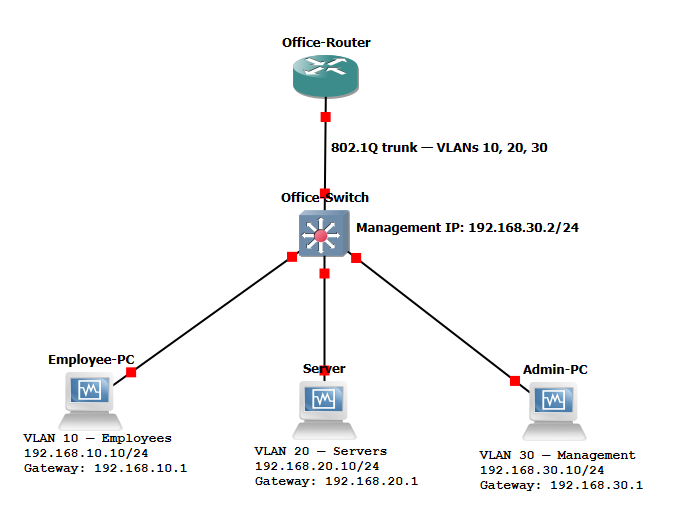

# Secure Office Network

A GNS3 network security lab that separates employees, servers, and management into three VLANs. An extended ACL allows employees to access the server over HTTPS while blocking other IPv4 traffic entering the router from the employee VLAN. SSH management access on the router and switch is restricted to Admin-PC.

## Tools

- GNS3 and Dynamips
- Cisco IOS 12.4 and an NM-16ESW EtherSwitch module
- VirtualBox with three Alpine Linux VMs
- OpenSSL, curl, and OpenSSH
- Wireshark

## Topology



Office-Router uses 802.1Q subinterfaces for inter-VLAN routing over one trunk to Office-Switch.

| Device or interface | VLAN | IPv4 address | Default gateway |
|---|---|---|---|
| Employee-PC | 10 — Employees | 192.168.10.10/24 | 192.168.10.1 |
| Server | 20 — Servers | 192.168.20.10/24 | 192.168.20.1 |
| Admin-PC | 30 — Management | 192.168.30.10/24 | 192.168.30.1 |
| Switch management | 30 | 192.168.30.2/24 | — |
| Router Fa0/0.10 | 10 | 192.168.10.1/24 | — |
| Router Fa0/0.20 | 20 | 192.168.20.1/24 | — |
| Router Fa0/0.30 | 30 | 192.168.30.1/24 | — |

| Switch port | Connection | Mode |
|---|---|---|
| Fa1/0 | Office-Router Fa0/0 | 802.1Q trunk |
| Fa1/1 | Employee-PC | Access VLAN 10 |
| Fa1/2 | Server | Access VLAN 20 |
| Fa1/3 | Admin-PC | Access VLAN 30 |
| Fa1/4–Fa1/15 | Unused | Administratively disabled |

## Security policy

Employee traffic entering router interface Fa0/0.10 is evaluated in order:

1. Permit TCP from 192.168.10.0/24 to Server at 192.168.20.10 on destination port 443.
2. Deny all remaining IPv4 traffic evaluated by this ACL.

```text
ip access-list extended EMPLOYEE-IN
 permit tcp 192.168.10.0 0.0.0.255 host 192.168.20.10 eq 443
 deny ip any any

interface FastEthernet0/0.10
 ip access-group EMPLOYEE-IN in
```

Router and switch remote management use a separate source-IP restriction:

1. Permit connections from Admin-PC at 192.168.30.10.
2. Deny other sources.
3. Require local account authentication and accept SSH only.

```text
ip access-list standard ADMIN-SSH
 permit host 192.168.30.10
 deny any

line vty 0 4
 access-class ADMIN-SSH in
 login local
 transport input ssh
```

Privilege level 15 determines commands available after authentication. It does not bypass either ACL.

## Additional hardening

- Explicit access mode was verified on the three endpoint ports.
- Unused switch ports Fa1/4–Fa1/15 were shut down.
- The trunk allowed list was narrowed to VLANs 1,10,20,30,1002–1005. This older EtherSwitch requires the default VLANs to remain included.
- Router and switch HTTP/HTTPS management services were disabled.
- The HTTPS private key was created with restrictive file permissions.
- Device configurations were saved, and router ACL persistence and Admin SSH access were checked after a restart.

## Verification results

HTTPS was tested successfully before applying the employee ACL, establishing that the service and network path worked.

| Test | Observed result |
|---|---|
| Employee → Server HTTPS, TCP 443 | Successful HTML response before and after the ACL |
| Employee → Server ping | Blocked after the ACL |
| Employee → switch management ping | Blocked |
| Employee → router and switch SSH before EMPLOYEE-IN | Denied by the management source restriction |
| Employee → router management SSH after EMPLOYEE-IN | Blocked before a password prompt |
| Admin → router SSH | Successful authenticated session |
| Admin → switch SSH | Successful authenticated session |
| HTTPS and blocked ping after switch hardening | Expected results retained |

ACL counters count packet matches, not successful logins or individual application requests. Their changes were compared with terminal results and packet captures.

### Packet evidence

| Capture | Evidence |
|---|---|
| [HTTPS allowed and ICMP blocked](Captures/employee-https-allowed-icmp-blocked.pcapng) | TCP setup, TLS 1.3 negotiation, encrypted traffic, and router ICMP filtering responses |
| [Employee management SSH blocked](Captures/employee-management-ssh-blocked.pcapng) | Employee TCP port 22 attempt and router rejection |
| [Admin SSH allowed](Captures/admin-router-switch-ssh-allowed.pcapng) | Router and switch SSH exchanges, supported by successful terminal logins |

The employee captures were taken on the Employee-PC–switch link, before router filtering. The Admin capture was taken on the Admin-PC–switch link.

For blocked ping, the router at 192.168.10.1 returned “Communication administratively filtered.” The rejected Echo requests were not forwarded to Server.

### Screenshots

- [Employee ACL and counters](screenshots/02-employee-acl.png)
- [HTTPS allowed](screenshots/03-https-allowed.png)
- [ICMP blocked](screenshots/04-icmp-blocked.png)
- [Employee management SSH blocked](screenshots/05-employee-ssh-blocked.png)
- [Successful Admin SSH login](screenshots/06-admin-ssh-allowed.png)
- [Unused ports disabled](screenshots/07-unused-ports-disabled.png)

## Recreating the lab

This repository contains documentation and configuration examples. Cisco IOS images, VM disks, private keys, and credentials are excluded.

1. Build the topology shown above using compatible, legally obtained device images and three Alpine Linux VMs.
2. Create VLANs 10, 20, and 30 on the EtherSwitch:

   ```text
   vlan database
   vlan 10 name Employees
   vlan 20 name Servers
   vlan 30 name Management
   exit
   ```

3. Review and apply the relevant settings from [office-router.txt](Configurations/office-router.txt) and [office-switch.txt](configurations/Office-switch.txt). Adapt interface names to your devices. Replace redacted credentials with your own, and generate each device's RSA keys for SSH.
4. Use [switch-vlans.txt](Configurations/switch-vlans.txt) to check VLAN membership.
5. Configure each Linux VM's `/etc/network/interfaces` using its corresponding file:
   - [Employee-PC](Configurations/employee-pc-interfaces.txt)
   - [Server](Configurations/server-interfaces.txt)
   - [Admin-PC](Configurations/admin-pc-interfaces.txt)
6. Follow [https-setup.txt](Configurations/https-setup.txt) to generate a new lab certificate and private key and start the HTTPS service.
7. Repeat the tests below and compare terminal output, ACL counters, and packet captures.

The configuration exports are reference material, not unattended deployment scripts. Review them before applying them.

## Test commands

From Employee-PC, with Server's HTTPS service running:

```sh
curl -k --connect-timeout 10 --max-time 20 https://192.168.20.10/
ping -c 3 192.168.20.10
ping -c 3 192.168.30.2
```

For SSH to the legacy router:

```sh
ssh -o ConnectTimeout=10 \
  -o KexAlgorithms=+diffie-hellman-group1-sha1 \
  -o HostKeyAlgorithms=+ssh-rsa \
  -o Ciphers=+aes128-cbc \
  labadmin@192.168.30.1
```

Run from Employee-PC to test rejection, and from Admin-PC to test an allowed login. Use 192.168.30.2 as the destination to test the switch.

On Office-Router:

```text
show access-lists EMPLOYEE-IN
show access-lists ADMIN-SSH
show ip interface FastEthernet0/0.10
```

Useful Wireshark display filters:

```text
ip.addr == 192.168.20.10 && tcp.port == 443
icmp && ip.addr == 192.168.20.10
tcp.port == 22 || icmp
ip.addr == 192.168.30.10 && tcp.port == 22
```

## Lab limitations

- This is an isolated educational lab using legacy Cisco IOS.
- The SSH compatibility options enable outdated algorithms for individual lab connections. They are not a modern production recommendation.
- The self-signed HTTPS certificate is tested with `curl -k`, which skips certificate verification while retaining encryption.
- OpenSSL `s_server` is a foreground test service and must be restarted after shutdown.
- EMPLOYEE-IN is a stateless IPv4 ACL. It does not inspect application content, restrict IPv6, or filter communication that stays within the same VLAN.
- The lab does not implement comprehensive policies for traffic originating in the Server or Management VLANs.
- The switch management interface is used from Admin-PC in the same subnet; a switch default gateway is not configured in the exported configuration.
- Console and auxiliary lines retain lab convenience settings, including no idle timeout and privilege level 15.
- An allowed source IP is not proof of a user's identity; account authentication is still required.

## What I learned

- How VLANs and an 802.1Q trunk support network segmentation.
- How to translate an access policy into ordered ACL rules.
- The difference between reachability, service availability, and authentication.
- How to verify controls with both allowed and blocked tests.
- How packet captures and ACL counters support a documented conclusion.